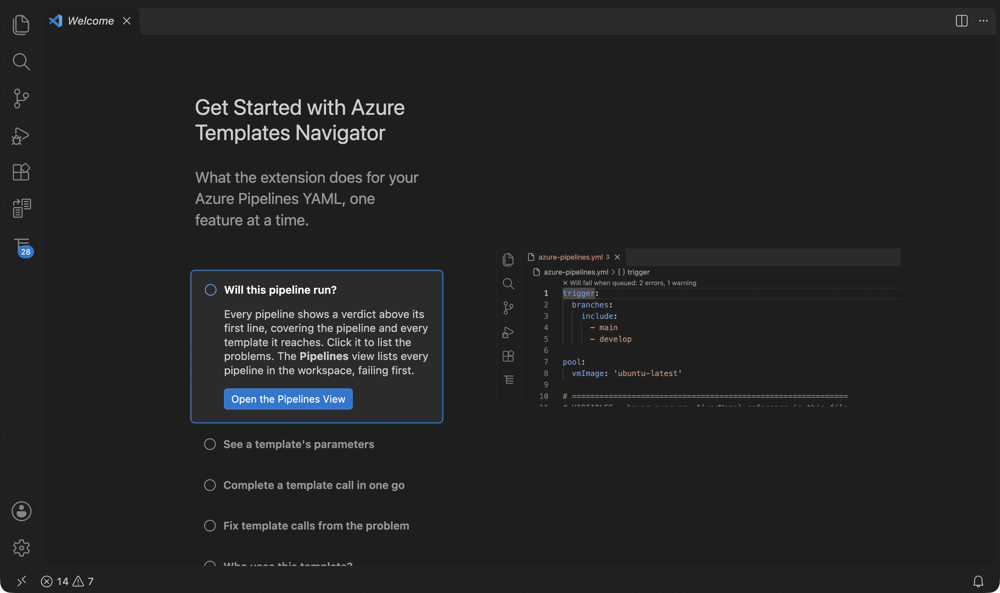

# Changelog

One changelog for the `atn` server, the VS Code extension and the IntelliJ plugin. They share a version.
For history before 2.0.0, see the CHANGELOGs of the former `azure-templates-vscode-extension` (1.x) and `azure-templates-intellij` (1.x) repositories.

## [2.12.0] — 2026-11-27

### Added

Five more checks for pipelines that Azure rejects when the run is queued, which atn used to pass as *✓ No problems found*. Each one was checked against Azure DevOps' own compile check.

- **Template cycles** (`template-cycle`). A template that includes itself, directly or through others, with the same parameters never stops expanding; Azure gives up with *Maximum object depth exceeded*. Recursion that ends, because an `${{ if }}` turns false with the values passed down, or that walks the items of an `${{ each }}`, is fine. A cycle through an `${{ if }}` that depends on runtime values is a warning naming the branch.
- **More than 100 YAML files in one pipeline** (`too-many-files`): the pipeline and every template it includes, each counted once. A warning when only `${{ if }}` branches decided at queue time take it past 100.
- **Dependency cycles** (`dependency-cycle`): stages or jobs that depend on each other in a loop, or on themselves. This includes a stage without `dependsOn`, which depends on the stage before it.
- **Defaults of the wrong type** (`default-type-mismatch`): `default: abc` for a `number`, `maybe` for a `boolean`, a list for a `string`, a plain value for a `step`. Azure checks the default whenever the parameter isn't passed, even if nothing reads it.
- **Unknown functions in `${{ }}`** (`unknown-function`), with *Did you mean …?*: `lenght(...)`, or `add(...)`, which Azure doesn't have. Inside an `${{ if }}` that depends on parameters it is a warning.

### Changed

- CI runs the full test suite (Go, the VS Code E2E, IntelliJ unit tests) on every push to `main` and every pull request, not only when a release is tagged.

## [2.11.0] — 2026-11-18

### Added

- **Check in Azure DevOps works for pipelines whose YAML lives on GitHub** (an Azure DevOps pipeline reading a GitHub repository through a service connection), including their templates and shared templates repositories on GitHub (`type: github` aliases). Set `repositories.azureDevOpsOrganization`, since a GitHub remote doesn't name it. Without `repositories.azureDevOpsProject`, every project is searched.
  - When only pipeline files changed in that repository, nothing is pushed: they are sent in the preview request.
  - Otherwise the snapshot is pushed to `refs/atn/preview/<you>/<branch>` on GitHub with your own git credentials, and deleted afterwards. The Azure DevOps token is never sent to GitHub. The confirmation dialog asks again before the first push to GitHub, even if you chose not to be asked.

### Fixed

- Parameters declared inline, `- { name: env, type: string, default: 'dev', values: [dev, prod] }` (one line or several), were not recognised, so every `${{ parameters.env }}` was reported as an undeclared parameter. *Declare parameter* now writes the inline form when the file uses it.
- A preview of a ref Azure can't resolve was counted as a rejected pipeline instead of *couldn't check*.

## [2.10.0] — 2026-11-18

### Added

- **`# atn-ignore <code>`** acknowledges a problem you keep on purpose, on the next line (or at the end of the line it is about); `# atn-ignore-file <code>` for the whole file. Every problem has two quick fixes that write the comment. Ignored problems don't count in verdicts.
  - A *Keep a known problem quiet* tip in Get Started (VS Code) and Tip of the Day (IntelliJ).
- **`${{ if }}` branches are decided** with the values a pipeline passes its templates (literals, forwarded `${{ parameters.x }}`, defaults, members of `object` values). A branch Azure skips is no longer checked for that pipeline. A branch that depends on runtime parameters or variables reports what it would break as a warning that names the branch, instead of an error.

### Changed

- Parameter names are matched case-insensitively, as Azure does. `appId` for a parameter declared `appID` is one information note, `param-casing`, with a quick fix, instead of *missing required* + *unknown parameter* (or *undeclared parameter* in a template body).
- `unknown-repository-alias` on a template is reported only when no pipeline reaches the template. When one does, its `repository-not-declared` says the same on the pipeline.

### Fixed

- A parameter whose value is a `{ }` or `[ ]` spanning several lines: its keys were reported as unknown parameters.
- `template:` as a key of an object passed to a parameter (`meta: { template: some/path }`) was read as a template call and reported as *template not found*. `template:` is a call only in a list item or under `extends:`.

## [2.9.0] — 2026-11-17

### Added

- **Check in Azure DevOps** (opt-in, off by default). Azure DevOps itself compiles every pipeline your changes reach, without running it, at the commit your work started from and with your changes. Under each pipeline in *My changes*: whether it compiles or is rejected, the problems Azure reports at their lines (the ones your changes added marked *new*), whether atn agrees, and *Expanded YAML changed*, which opens the pipeline as Azure expanded it, base against your changes, in a diff editor.
  - Start it from the Pipelines view's title or the *Check in Azure DevOps* row (VS Code), or the Pipelines tab's toolbar (IntelliJ). A dialog lists what will be sent and asks first, every time unless you choose otherwise.
  - Your changed YAML files, unsaved editors included, are pushed as one commit to `refs/atn/preview/<you>/<branch>` (not a branch: no CI run, no pull request) and the ref is deleted after the check. No run is queued. If a repository refuses the push, only the pipelines that need it are left unchecked, with the server's reason.
  - Signs in with the Azure CLI (`az login`), for your organization's tenant, so no personal access token is needed. `ATN_AZURE_TOKEN` takes a token directly.
  - Settings: `azure.enabled`, `azure.keepSnapshots`, `azure.azPath`.
- **`atn validate`** does the same in a terminal. It exits with 1 when your changes make Azure reject a pipeline and 2 when it couldn't check one; `--diff` prints how each expanded pipeline changed, `--format json` for scripts. `--root` can be given once per repository, for a change that spans a templates repository and the one that uses it.

## [2.8.0] — 2026-11-17

### Added

- **What did my changes break?** The Pipelines view (VS Code) and tab (IntelliJ) have a second view, *My changes*. It compares the workspace with the commit your work started from, and lists only the pipelines your changes reach. For each one it shows the problems your changes added, the ones they fixed, and how many were already there. Commits you have pushed count as your work too, along with uncommitted edits and unsaved editors. A problem that only moved lines is not new. A problem in a template that several pipelines use counts once.
  - **Where your work started:** on the default branch, your unpushed commits. On a branch created from another branch, where it splits from that branch, even after a rebase. Otherwise, where it splits from the default branch. The first row shows the base; click it to choose *uncommitted changes only*, a branch or a commit. The choice is stored per branch in `git config`.
  - **The big picture stays visible:** a row with how many pipelines fail in total, the *new* marks in the full list, and *+2 new since feature/story* on the verdict above each pipeline.
  - The files you changed come first, under the row that says where your work started.
  - The **Diagnostics** view (tab) has the same switch, shared with the Pipelines view: in My changes it lists only the problems your changes added.
  - **Quiet the Problems panel:** with `changes.dimExistingProblems` (off by default), errors and warnings that were already there before your changes show as information, ending with *(already there at origin/main)*. Verdicts, views and the CLI keep the real severities.
  - A *What did my changes break?* tip in Get Started (VS Code) and Tip of the Day (IntelliJ).
  - Setting: `changes.enabled` (on by default).
- **`atn check --since REF`** reports, and fails on, only the problems that are new since a branch, commit, `HEAD` or `auto`. A repository can gate pull requests on adding no new problems before the existing ones are fixed. It exits with 2 when `REF` is missing or shares no history with `HEAD` (a shallow checkout), instead of comparing with the wrong commit.

## [2.7.0] — 2026-11-17

### Added

- **Feature guide.** [docs/README.md](https://github.com/qSharpy/azure-templates-navigator/blob/main/docs/README.md) shows every feature with screenshots and GIFs from both IDEs, and the default shortcut for each in VS Code and IntelliJ, on macOS and on Windows/Linux. *Documentation* in *Help and Feedback* (VS Code) and under the tool window's bug button (IntelliJ) opens it.
- **Tips, one feature at a time.** Eleven short tips, from "will this pipeline run?" to `atn check` in CI. Most have a screenshot or a GIF of the feature. One list for both IDEs, in `shared/tips/tips.json`.
  - VS Code: a *Get Started* walkthrough, opened from the *Help and Feedback* view, *Azure Templates: Get Started*, or *Help → Welcome*. Most steps have a button that opens the view or command they describe.
  - IntelliJ: the tips appear in *Help → Tip of the Day*. *Help → Azure Templates Navigator Tips* (or *Get Started* under the tool window's bug button) pages through only these, in a window that stays open while you try them in the editor.

  
- **Check: repository without a service connection.** A `type: github`, `githubenterprise` or `bitbucket` repository under `resources.repositories` without `endpoint:` is an error (`repository-missing-endpoint`): Azure rejects the run when it is queued. Azure Repos (`type: git`) needs no endpoint.
- **What's New.** Once per version, after an update, a notification offers the changelog and the tips. *What's New* is also in *Help and Feedback* (VS Code) and under the bug button (IntelliJ).

### Fixed

- **IntelliJ: a file opened after the language server started showed no problems** until it was edited. The server sent each file's diagnostics once and only again when they changed, and IntelliJ (LSP4IJ) doesn't keep the ones that arrive before a file is opened. Now the server sends a file's diagnostics each time it is opened. This also affects 2.6.0 and earlier.

## [2.6.0] — 2026-11-16

### Changed

- **Repositories view shows what you use from each repository.** Under a repository: the templates the workspace uses from it, most used first, with their usage counts (a template that can't be found is marked and opens its first call). The files that declare it moved into a collapsed *Declared in* group, and each one opens at its `resources.repositories` entry. Before, each declaring file was a bare "declared in" row that did nothing when clicked.
- **Stats rows lead somewhere specific.**
  - *Errors* and *Warnings* expand to the files that have them, most first; click one to go to its first problem.
  - *Broken references* expands to each broken `template:` reference, with the file and line it is on; click one to go to it.
  - *Pipelines* and *Repositories* open those views. *Templates* and *External templates* show that kind in the graph.
- **Template graph.**
  - Files with the same name are told apart: `build/template.yml` and `deploy/template.yml` instead of two `template.yml`. The label is the shortest end of the path that is unique, and long labels are shortened from the front so the file name stays.
  - Clicking a node selects it: it stays lit with every pipeline and template that leads to it and everything it calls, and the rest dims. Click the background to clear it.
  - In workspace scope, the file open in the editor is selected and centred, and the counts overlay says *Workspace*, so it's clear the graph isn't following the editor.

### Fixed

- **Show in Graph on a file** clears filters left by an earlier *Show in Graph* (for example *problems only* from the Errors row), so the graph shows all of the file's callers, matching its usage counts.
- **Fetch / Update** in the Repositories view now passes the declaring file, so the right declaration is fetched when two files use the same alias for different repositories.

## [2.5.0] — 2026-11-16

### Added

- **"Will this pipeline run?" before you run it.** Every pipeline gets a verdict above its first line, for example `✗ Will fail when queued: 2 errors` or `✓ No problems found before running`.
  - It covers the pipeline and every template it uses, including templates in other repositories.
  - Click it (or run **Check Pipeline Before Running** from the editor's right-click menu, or the command palette in VS Code) to list the problems and jump to one.
  - **Pipelines view** (VS Code: Azure Templates sidebar; IntelliJ: a Pipelines tab): every pipeline in the workspace with its verdict, failing first, and "2 of 7 will fail" at the top, so you don't have to open each one. Expand a pipeline for its problems and click one to jump to it. In VS Code, the view's badge counts the failing pipelines.
  - `atn/pipelineCheck` reports now carry `verdict` (`fail`, `warn` or `ok`) and `filePath`; each problem carries `filePath` too.
  - `atn check` prints the same verdicts for every pipeline. `atn check path/to/pipeline.yml` checks that pipeline together with all of its templates.
- **New checks for what Azure rejects when a run is queued** (errors):
  - `repository-not-declared`: a template, at any depth, uses `x.yml@alias` or `checkout: alias`, and the pipeline doesn't declare `alias` in `resources.repositories`. Azure looks aliases up in the pipeline's resources, not the template's. Quick fix: copy the declaration from another pipeline in the workspace.
  - `unknown-dependency`: `dependsOn` names a stage or job that exists nowhere in the expanded pipeline, with "did you mean".
  - `invalid-name`: stage and job names may only contain letters, digits and `_`.
  - `duplicate-name`: the same stage or job name twice in one list.
  - `template-kind-mismatch`: a steps template used under `jobs:` or `stages:`, and the like.
  - `default-not-allowed`: a parameter's `default` is not one of its `values`. Quick fix: pick an allowed value.
  - `tab-indentation`: tabs in YAML indentation.
- **New checks for what goes wrong during the run** (warnings):
  - `unknown-output-variable`: `outputs['step.var']` names a step that doesn't exist, so the value is always empty.
  - `output-variable-not-output`: the step sets the variable without `isOutput=true`, so other jobs always see an empty value.
  - `runtime-param-no-default`: a runtime parameter without a default, in a pipeline that a CI trigger or a schedule starts. Nobody can fill in the value on those runs.

### Changed

- **The graph shows which file it is built around.** When the graph is scoped to the current file, a *Graph of `<file>`* badge sits in the top-left corner; click it to centre the graph on that file. The file's node has a solid ring, a soft halo, a *CURRENT FILE* tag and a bold label, and it pulses briefly when the graph is drawn. Before, it only had a thin dashed ring. The legend explains the ring.
- **`unknown-param` is an error** when the template declares typed parameters (`- name:`). Azure rejects the run with "Unexpected parameter".
  - It is a warning when the template declares no parameters at all. Before, nothing was reported there.
  - It is information only for legacy map-form parameter blocks (`name: default`). Those accept parameters they don't declare.
- **`undeclared-param` takes legacy templates' callers into account.** In a map-form template, a name that a caller passes is no longer reported as undeclared.
- A pipeline's diagnostics are re-checked when any template it reaches changes, not only the ones it calls directly.

## [2.4.0] — 2026-11-16

### Added

- **Completing a template path adds its required parameters.** Pick a template after `template:` and a `parameters:` block with every required parameter comes with it, lined up under `template:`. Tab moves between the values; allowed values and booleans are offered as a choice. Nothing is added when the call already has `parameters:`. Turn it off with `completion.requiredParameters` (IntelliJ: Settings → Tools → Azure Templates Navigator → Completion).
- **Stats: Problems by type**, right under Overview. Errors and warnings per kind (missing required parameter, unknown parameter, type mismatch, value not allowed, template not found, …), most frequent first. Expand a kind for the files that have it, most first; click a file to open its first one. `atn/stats` rows can now have `children` and a `line`.

### Changed

- **IntelliJ: the tool window's tabs are always visible.** They moved from the tool window header, where IntelliJ hides the tabs that don't fit behind a dropdown, into a tab strip that wraps onto more rows when the tool window is narrow. The tabs keep their order.

- **Hubs stand out more in the graph.** The size scale is steeper and its cap is twice as high, so a template used by 100 files is about twice as big as before. Before, everything above about 40 callers + callees drew at the same size. Sizes still follow workspace-wide numbers, so a node keeps its size whatever the scope, depth or filters. *Fit* now leaves room for the biggest nodes.

### Fixed

- **"Request textDocument/documentSymbol failed: selectionRange must be contained in fullRange"** in VS Code ([#7](https://github.com/qSharpy/azure-templates-navigator/issues/7)). A blank line or a column-0 comment inside top-level `parameters:` ended the section early in the outline, so parameters after it got an end line before their start line. Variables after such a comment were missing from the outline. The server now also clamps every symbol range, so one bad symbol can't break the whole outline.
- **IntelliJ 2026.3: only the Dependencies tab showed up, with no bug button.** IntelliJ 2026.3 moved the embedded browser (JCEF) out of the platform into the bundled *Web Browser (JCEF)* plugin, so the Graph tab couldn't load its classes. The plugin now declares that dependency (optional, so older IDEs are unaffected). The failing Graph tab also stopped every tab after it from being added. Each tab is now created on its own, and a tab that fails explains why in place. The bug button is set up first.
- **The graph legend couldn't be closed** ([#8](https://github.com/qSharpy/azure-templates-navigator/issues/8)). Its size icons stretched to the size of the graph, pushing the toggle out of view. The legend now never grows taller than the graph, and scrolls when it has to.

## [2.3.0] — 2026-11-16

### Added

- **Graph nodes are sized by how connected they are.** Size follows callers + callees, counted over the whole workspace, so a widely used template stays big when the graph shows only the current file. The scale is a square root, so hubs don't swamp the view.
  - Hovering a node shows how many files and call sites use it, how many pipelines reach it, what it calls, its parameters, and its errors and warnings.
  - Files with errors or warnings get a red or amber badge.
- **Node and edge counts** in the corner of the graph: "23 of 87 nodes · 31 of 140 edges" when a filter is on.
- **Graph filters.**
  - *Problems*: only files with errors or warnings, and missing templates, unknown aliases or unavailable repositories.
  - *Kinds*: pipelines, templates, external templates, broken references.
  - *Repositories*: this workspace and each repository templates come from.
  - With *Problems* or *Repositories*, the direct callers of what matches stay visible, faded, so you can see who uses it.
  - Around the current file: callers only, callees only, or both, next to the depth.
  - VS Code: a filter bar under the graph toolbar, and *Focus graph here* on a node's menu. IntelliJ: *Only Problems*, a *Filter* popup and a direction combo in the Graph tab's toolbar.
- **Stats view** (VS Code: under Repositories; IntelliJ: a Stats tab), for teams that publish templates:
  - Overview: pipelines, templates, external templates, repositories, errors, warnings, broken references.
  - Most used: call sites, files and pipelines reached. These are the templates a parameter change affects most.
  - Most mis-called: templates whose call sites have the most parameter problems, often a sign of a confusing interface.
  - Calls the most templates.
  - Not referenced in this workspace: candidates for clean-up. Templates published for other repositories show up here too.
  - By repository: templates, call sites and files using each repository.
  - Click a row to open the file. *Show in Graph* centres the graph on it, filters it to the repository, or shows only problems.
- `atn/stats` request and new `atn/graph` parameters (`direction`, `problemsOnly`, `kinds`, `repos`). The response adds per-node usage numbers, `totalNodes`, `totalEdges` and `facets`.

## [2.2.0] — 2026-11-16

### Added

- **Report a bug or an idea from the IDE.** It opens a new GitHub issue with the extension, `atn`, IDE and OS versions filled in. Nothing is sent until you submit it.
  - VS Code: a *Help and Feedback* view in the Azure Templates sidebar, a bug button on the Dependencies and Diagnostics views, and *Azure Templates: Report Issue…*. The Marketplace page and *Help → Report Issue* link to the issue tracker too.
  - IntelliJ: a bug button in the Azure Templates tool window header, and *Help → Report Azure Templates Navigator Issue…*. When the plugin throws, IntelliJ's error dialog offers *Report to Azure Templates Navigator*, with the stack trace in the issue.
  - GitHub issue forms for bug reports and feature requests.
  - Both also link to the documentation and the log, and *Give Feedback* opens the extension's reviews on the Visual Studio Marketplace or JetBrains Marketplace.

## [2.1.0] — 2026-11-03

### Fixed

- **`template:` text inside a script is no longer treated as a template call.** Lines in a block scalar (`script: |`, `bash: >-`, `- |`, ...) are shell, not YAML structure.
  - Before, a script that printed `template: x.yml` got a "template not found" error, and its line showed up in usages, the call hierarchy and the graph.
  - The outline and variables lookup skip script bodies too.
- **Parameters passed as a flow mapping are recognised:** `parameters: { env: prod, count: 3 }`, on one line or over several.
  - Before, every required parameter was reported missing, and typos and wrong values were never flagged.
  - Quick fixes edit inside the braces: add missing parameters, remove or rename an unknown one, change a value.
  - Hover, go-to-definition and find usages work on the keys.
- **`parameters: ${{ parameters }}`** (forwarding everything to another template) no longer reports every required parameter as missing.
- **Type-mismatch and value-not-allowed ranges** stop at the value. Their quick fixes no longer delete a trailing comment.

### Performance

- **Edits re-check only what they affect.**
  - Changing a file re-links that file. It re-checks the file, its callers, and any file whose reference it makes appear or disappear.
  - Before, every keystroke rebuilt the call graph and re-checked the whole workspace. On a 2,200-file workspace that took about 33 ms per keystroke, against about 0.4 ms now.
  - A change to `resources.repositories` still rebuilds everything, because aliases resolve references in other files.
- **Only changed diagnostics are republished.**
- **The tree views and the graph reload only when something changed.** Both IDEs refresh them on the server's `atn/didChange` notification, which was sent after every keystroke.
- **Requests no longer queue behind each other.** The server reads document changes and `$/cancelRequest` while a request is running. Requests run on worker goroutines, and a request cancelled before it starts is answered with `RequestCancelled`.
- **YAML that isn't Azure Pipelines is left out of the index:** Kubernetes manifests, GitHub Actions workflows, docker-compose files, Helm values and the like. They get no diagnostics, graph nodes or template-path completions.

## [2.0.0] — 2026-11-03

### Architecture

- **One engine for both IDEs.** All logic moved into `atn`, a Go language server and CLI bundled with each plugin.
  - The VS Code extension and the IntelliJ plugin are now thin LSP clients, so features and fixes land in both at once.
  - Settings have the same names and meaning everywhere, enforced by parity tests.
- **One graph webview** is shared by both IDEs.

### Added

- **Automatic download of templates from other repositories** (`template: x.yml@alias`).
  - Supported types: GitHub, Azure Repos, GitHub Enterprise and Bitbucket.
  - Repositories are resolved via `localPaths`, then a sibling clone, then a shared cache (`~/.azure-templates-navigator/repos`).
  - The cache holds shallow fetches of the exact `ref` and refreshes in the background.
  - Downloads use the user's existing git credentials and never prompt.
  - **Fetch repository** is available as a hover link and as a quick fix. A new **Repositories** view shows each repository's state, commit and age.
  - Azure DevOps organization and project are inferred from the workspace remote.
  - Templates that use an alias they don't declare resolve it through the pipelines that do.
- **`.azure-templates-navigator.json`**: a committable, team-wide repository configuration.
- **New diagnostics:**
  - value not in `values:`
  - template file not found
  - unknown repository alias
  - repository unavailable or still downloading
  - "did you mean …" for misspelled parameter names
- **New quick fixes:**
  - rename a misspelled parameter
  - add all missing required parameters
  - pick an allowed value
  - create the `parameters:` block when it's missing
- **Completion:** template paths after `template:`, plus allowed values and booleans.
- **Hover:** works on passed parameters and on `${{ parameters.x }}` inside templates, and shows where an external repository was resolved from.
- **`atn` CLI:** `check` (text, JSON or Azure Pipelines annotations), `fetch`, `repos`.
- **IntelliJ:** *Search Template Parameters…* in the editor context menu, matching the VS Code hover link.

- **`extends:` templates are validated like `template:` calls.**
  - Before, parameters written next to `template:` were ignored, so every required parameter was reported missing and typos were never flagged.
  - Hover, completion and go-to-definition now also work inside `extends: parameters:`.
  - `parameters:` may come before or after `template:`.
- **New diagnostic `undeclared-param`:** `${{ parameters.x }}` where `x` is not declared. Azure evaluates it to an empty string instead of failing.
  - Quick fixes: change to the closest declared name, or declare the parameter (with `default: ''`, so callers keep today's behaviour).
- **Find usages** of a template, or of one of its parameters: the declaration, the uses in the template body, and every call site that passes it. In IntelliJ: Find Usages. In VS Code: Find All References.
- **Call hierarchy:** which pipelines and templates reference a template, and which templates it references. In IntelliJ: Ctrl+Alt+H. In VS Code: Show Call Hierarchy.
- **"N usages · M pipelines"** above every template (Code Vision in IntelliJ, a code lens in VS Code). Clicking it lists the call sites.
- **Outline of pipelines and templates:** parameters, variables, repositories, stages → jobs → steps, template calls and `${{ if }}` blocks. In IntelliJ: the Structure view. In VS Code: Outline and breadcrumbs.
- **`samples/extends/`:** an example organisation with platform and security template repos and four consumer teams, including the expected diagnostics.

### Changed

- **IntelliJ looks like IntelliJ:**
  - Find Usages, Call Hierarchy, Code Vision and the Structure view replace VS Code-style affordances.
  - Gutter icons on `template:` references.
  - The graph has an IntelliJ toolbar (follow current file, depth, full paths, fit, search) and IntelliJ context menus on nodes.
  - Documentation popups have no emoji or inline HTML.
  - New tool window icon.
- **Graph:** the context menu no longer shows raw icon codes such as `$(go-to-file)`.

- **IntelliJ:** requires 2024.2+ and the LSP4IJ plugin, which the Marketplace installs automatically. All views are now tabs of one **Azure Templates** tool window.
  - Settings are stored in a new file, so 1.x settings start from the 2.0 defaults. Set them again under *Settings → Tools → Azure Templates Navigator*.
- **VS Code:**
  - The `azure-templates-navigator.diagnostics.debounceMs` setting was removed, because the server now debounces changes itself. If you had set it, VS Code greys it out as an unknown setting in `settings.json`, and you can delete it.
  - Tree view filter toggles were simplified.
- **Unicode parameter names** are recognised everywhere.
