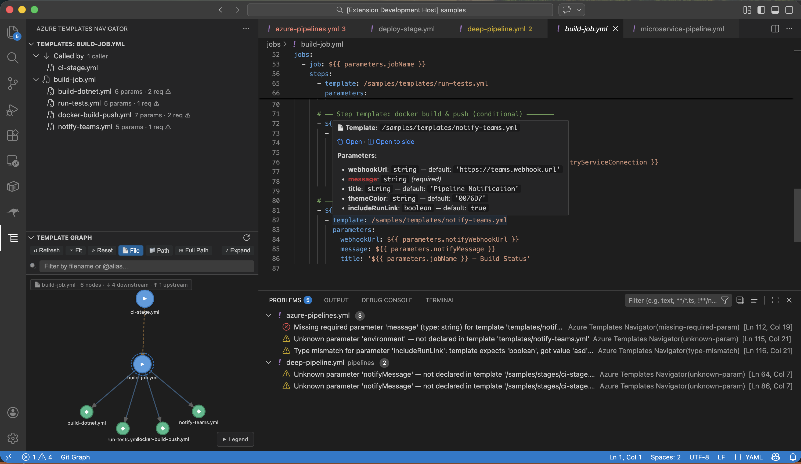
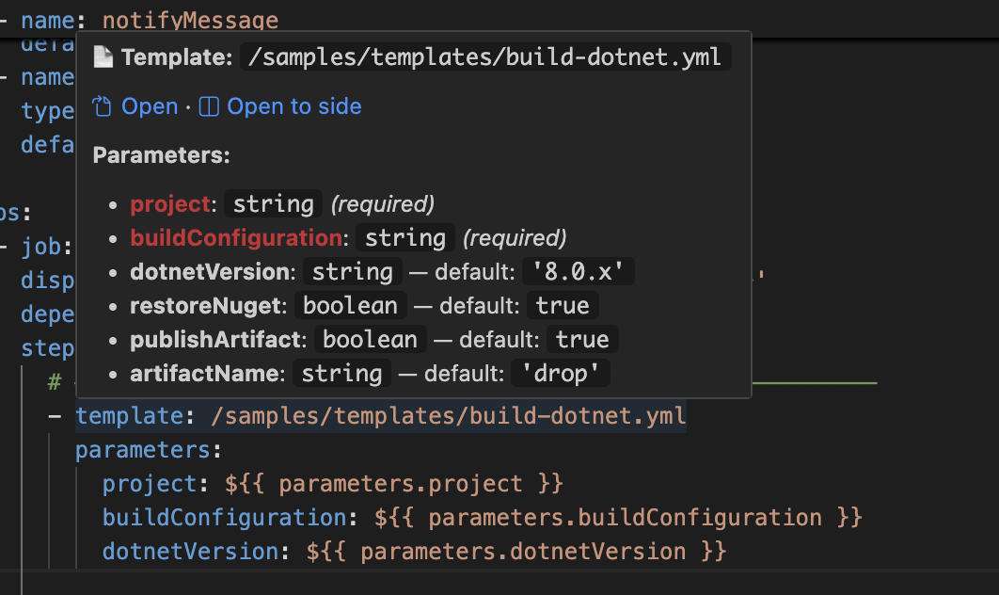
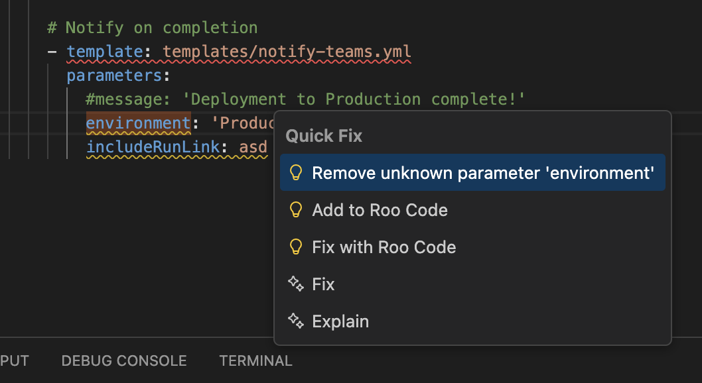
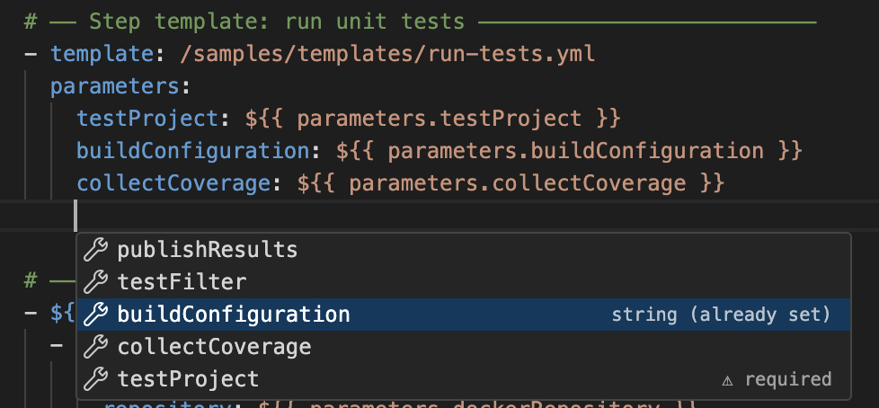
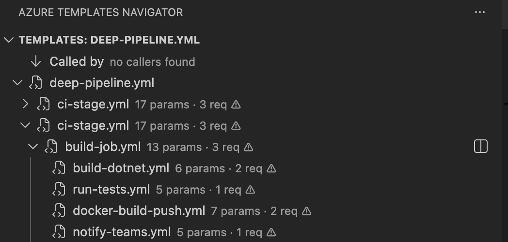
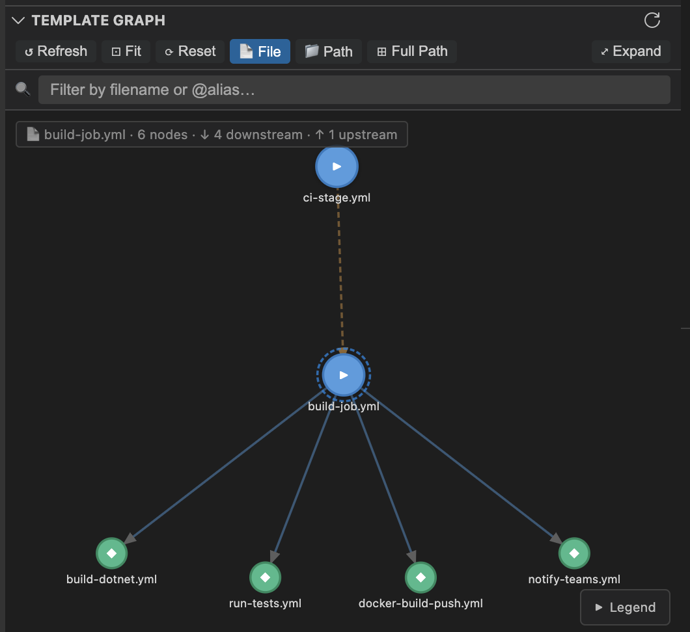

# Azure Templates Navigator

Hover, validate, complete and navigate **Azure Pipelines YAML templates**. This includes templates that live in other repositories, which are downloaded for you.



Also available for JetBrains IDEs, with the same engine and the same settings, and as an `atn` CLI for CI.

## Features

### Hover any `template:` line



- **Parameters.** Every parameter with its type, default and allowed values. Required ones are highlighted. A **Search** link filters long parameter lists and jumps to a declaration.
- **Repository.** For `x.yml@alias`, the hover shows which repository, ref and copy (local clone or cache) was used, and how old it is.
- **Fetch.** If the repository isn't available yet, the hover shows a **Fetch repository** link.

Hover also works on a passed parameter (`  env: prod`), on `${{ parameters.x }}` inside a template, and on `$(variable)` / `variables.x`.

### Validation and quick fixes



| Check | Quick fix |
|---|---|
| Missing required parameter | Add it (or add all missing ones at once) |
| Unknown parameter, with "did you mean …" | Rename it, or remove it |
| Wrong type (e.g. `'yes'` for a `boolean`) | Replace with the right literal |
| Value not in `values:` | Pick an allowed value |
| Parameter declared but never used | Remove the declaration |
| Template file not found / unknown `@alias` | — |
| Repository not downloaded | Fetch repository |

### Completion



- **Parameter names** under `parameters:`, with required ones first.
- **Allowed values** and booleans.
- **Template paths** after `template:`.

### Dependency tree, graph and repositories




- **Dependencies** shows what the current file calls and who calls it.
- **Graph** is an interactive view of the current file or the whole workspace.
- **Diagnostics** lists the problems across the workspace.
- **Repositories** lists every `resources.repositories` entry with its state, commit and age, plus fetch and open actions.

## Templates from other repositories

```yaml
resources:
  repositories:
    - repository: templates
      type: github                       # github · git (Azure Repos) · githubenterprise · bitbucket
      name: my-org/pipeline-templates
steps:
  - template: build.yml@templates        # ← hover works, no manual clone needed
```

The repository is resolved from, in order:

1. `repositories.localPaths`
2. a clone next to your repo, `../pipeline-templates`
3. the shared cache, `~/.azure-templates-navigator/repos/…`

The cache is a shallow, read-only git fetch of the exact `ref`. It uses your existing git credentials (SSH, Git Credential Manager, `gh auth setup-git`) and never prompts.

- **Azure Repos.** Organization and project are read from your repo's remote. If they can't be inferred, set `repositories.azureDevOpsOrganization`.
- **Team-wide settings.** Commit a `.azure-templates-navigator.json` next to your pipelines:

```json
{ "repositories": { "urls": { "templates": "git@github.com:my-org/pipeline-templates.git" } } }
```

## Settings

| Setting | Default | |
|---|---|---|
| `azure-templates-navigator.repositories.autoFetch` | `true` | Download referenced repositories automatically |
| `azure-templates-navigator.repositories.cacheDir` | `~/.azure-templates-navigator/repos` | Shared with the JetBrains plugin and the CLI |
| `azure-templates-navigator.repositories.refreshIntervalHours` | `12` | Re-fetch cached copies in the background (0 = never) |
| `azure-templates-navigator.repositories.preferLocalClones` | `true` | Use `../<repo>` when it exists |
| `azure-templates-navigator.repositories.urls` / `localPaths` | `{}` | Per alias, `org/repo` or repo name |
| `azure-templates-navigator.repositories.azureDevOpsOrganization` / `azureDevOpsProject` | | When it can't be inferred |
| `azure-templates-navigator.repositories.githubEnterpriseHost` | | For `type: githubenterprise` |
| `azure-templates-navigator.diagnostics.enabled` | `true` | |
| `azure-templates-navigator.diagnostics.unusedParameters` | `true` | |
| `azure-templates-navigator.requiredParameterColor` | `#c92d35` | Hover highlight |
| `azure-templates-navigator.graph.rootPath` | | Sub-folder for the workspace graph |

## Commands

- *Azure Templates: Search Templates…*
- *Search Template Parameters…*
- *Fetch All Repositories*
- *Open Cache Folder*
- *Refresh*
- *Restart Language Server*
- *Show Output*

## Use it in CI

```bash
atn check --format azure   # emits ##vso[task.logissue] annotations, exit code 1 on errors
```

See the [project README](https://github.com/qSharpy/azure-templates-navigator#cli) for details.
