# Azure Templates Navigator: feature guide

Everything the extension (VS Code) and the plugin (IntelliJ IDEA and the other JetBrains IDEs) do for Azure Pipelines YAML, with
the shortcut for each. Both run the same engine, so a feature behaves the same in both IDEs. Only the place you find it differs.

The screenshots use the repository's [`samples/`](../samples) folder. Open it to try each feature as you read.

- [Shortcuts](#shortcuts)
- [Will this pipeline run?](#will-this-pipeline-run)
- [A template's parameters](#a-templates-parameters)
- [Complete a template call in one go](#complete-a-template-call-in-one-go)
- [Problems and quick fixes](#problems-and-quick-fixes)
- [Who uses this template?](#who-uses-this-template) — Find Usages and **Call Hierarchy**
- [Outline of a pipeline](#outline-of-a-pipeline)
- [Template graph](#template-graph)
- [Dependencies and Diagnostics](#dependencies-and-diagnostics)
- [Templates from other repositories](#templates-from-other-repositories)
- [Stats for template owners](#stats-for-template-owners)
- [Search templates](#search-templates)
- [Tips, help and feedback](#tips-help-and-feedback)
- [In a terminal or a pipeline](#in-a-terminal-or-a-pipeline)

## Shortcuts

These are the IDEs' default keymaps. Each one runs an IDE feature that the extension feeds, so a shortcut you've remapped in the IDE works here too.

| To | VS Code (macOS / Windows, Linux) | IntelliJ (macOS / Windows, Linux) |
|---|---|---|
| See a template's parameters | hover, or <kbd>⌘K</kbd> <kbd>⌘I</kbd> / <kbd>Ctrl+K</kbd> <kbd>Ctrl+I</kbd> | <kbd>F1</kbd> / <kbd>Ctrl+Q</kbd> (Quick Documentation) |
| Open the template | <kbd>⌘</kbd>-click or <kbd>F12</kbd> / <kbd>Ctrl</kbd>-click or <kbd>F12</kbd> | <kbd>⌘</kbd>-click or <kbd>⌘B</kbd> / <kbd>Ctrl</kbd>-click or <kbd>Ctrl+B</kbd>, or the gutter icon |
| Complete a path, a parameter or a value | <kbd>⌃Space</kbd> / <kbd>Ctrl+Space</kbd> | <kbd>⌃Space</kbd> / <kbd>Ctrl+Space</kbd> |
| Fix the problem at the cursor | <kbd>⌘.</kbd> / <kbd>Ctrl+.</kbd> | <kbd>⌥⏎</kbd> / <kbd>Alt+Enter</kbd> |
| Go to the next problem | <kbd>F8</kbd> | <kbd>F2</kbd> |
| List every problem | <kbd>⇧⌘M</kbd> / <kbd>Ctrl+Shift+M</kbd> (Problems) | <kbd>⌘6</kbd> / <kbd>Alt+6</kbd> (Problems) |
| Find who uses a template or parameter | <kbd>⇧⌥F12</kbd> / <kbd>Shift+Alt+F12</kbd> (Find All References), <kbd>⇧F12</kbd> to peek | <kbd>⌥F7</kbd> / <kbd>Alt+F7</kbd> (Find Usages), <kbd>⌥⌘F7</kbd> / <kbd>Ctrl+Alt+F7</kbd> (Show Usages popup) |
| **See the chain from pipeline to template** | <kbd>⇧⌥H</kbd> / <kbd>Shift+Alt+H</kbd> (Show Call Hierarchy) | <kbd>⌃⌥H</kbd> / <kbd>Ctrl+Alt+H</kbd> (Call Hierarchy) |
| Jump to a stage, job or step | <kbd>⇧⌘O</kbd> / <kbd>Ctrl+Shift+O</kbd> (Go to Symbol in Editor) | <kbd>⌘F12</kbd> / <kbd>Ctrl+F12</kbd> (File Structure) |
| Run any of the extension's commands | <kbd>⇧⌘P</kbd> / <kbd>Ctrl+Shift+P</kbd>, then type *Azure Templates* | <kbd>⇧⌘A</kbd> / <kbd>Ctrl+Shift+A</kbd> (Find Action), or *Tools → Azure Templates* |

## Will this pipeline run?

Every pipeline shows a verdict above its first line. It covers the pipeline and every template the pipeline reaches, so a broken
template shows up on each pipeline that uses it. Errors mean Azure DevOps rejects the run when it is queued. Warnings mean the run
starts but is likely to fail or misbehave.

Click the verdict to list the problems, each at the line in the pipeline that leads to it. *Check Pipeline Before Running* in
the editor's right-click menu does the same. The **Pipelines** view (VS Code) or tab (IntelliJ) lists every pipeline in the
workspace, failing first.

| VS Code | IntelliJ |
|---|---|
|  | 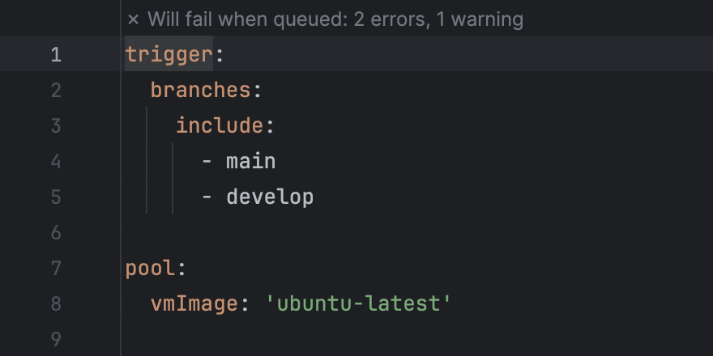 |
| 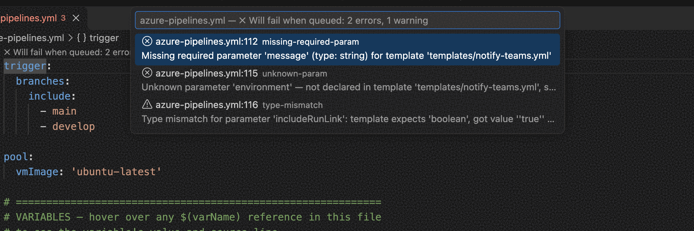 | 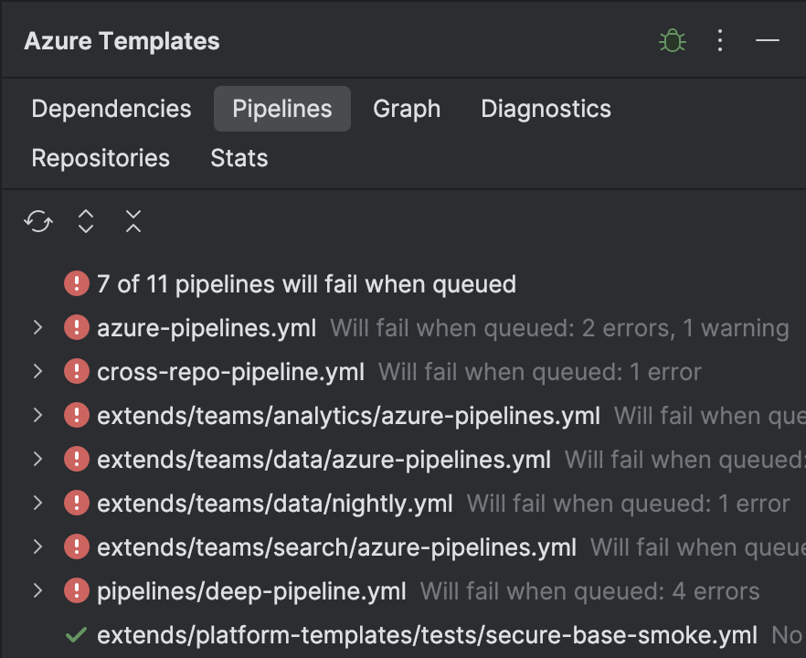 |
| 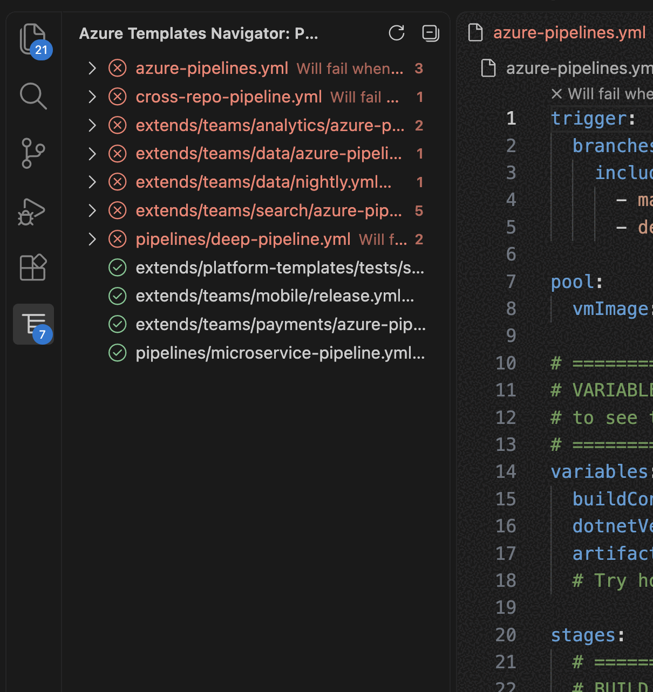 | |

## A template's parameters

Hover a `template:` line (VS Code), or put the caret on it and press <kbd>F1</kbd> / <kbd>Ctrl+Q</kbd> (IntelliJ). You see every
parameter with its type, default and allowed values, and the required ones are marked. The same works on:

- a parameter you pass (`  env: prod`)
- `${{ parameters.x }}` inside a template
- `$(variable)` and `variables.x`: the value and the line that sets it

<kbd>⌘</kbd>/<kbd>Ctrl</kbd>-click opens the template. In IntelliJ the gutter icon next to `template:` does too.

| VS Code | IntelliJ |
|---|---|
| 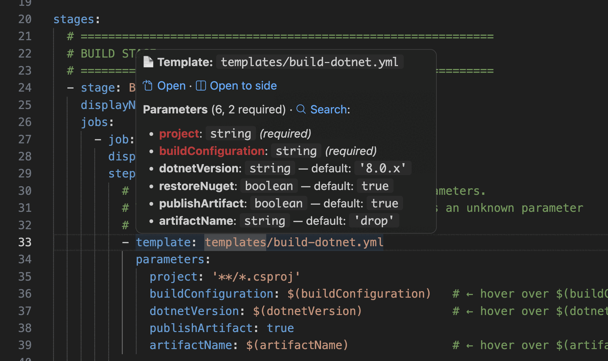 |  |
| 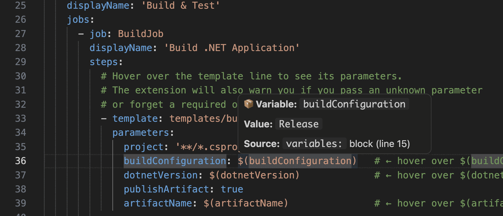 | |

## Complete a template call in one go

After `template:`, completion lists the templates in the workspace and in the repositories you declared. Picking one also
inserts a `parameters:` block with the template's required parameters. Press Tab to move between their values.

Under `parameters:`, completion offers the template's parameter names, required first, and then their allowed values. To insert
only the path, turn off `completion.requiredParameters`: in VS Code it's under *Settings → Azure Templates Navigator*, in IntelliJ
under *Settings → Tools → Azure Templates Navigator*.

| VS Code | IntelliJ |
|---|---|
| 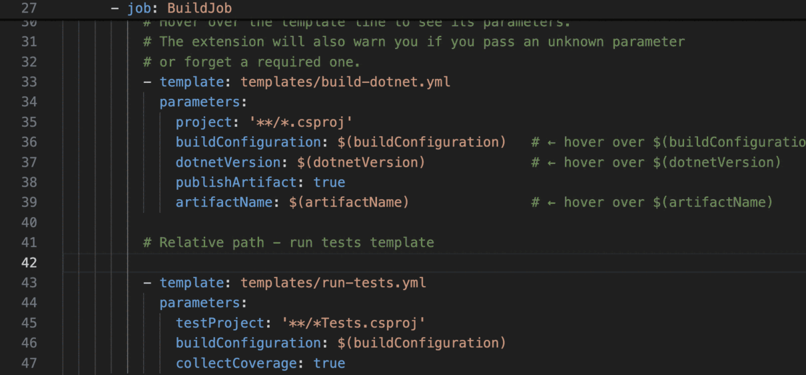 |  |

## Problems and quick fixes

Problems are reported as you type, on the line that causes them. Most have a quick fix: <kbd>⌘.</kbd> / <kbd>Ctrl+.</kbd> in
VS Code, <kbd>⌥⏎</kbd> / <kbd>Alt+Enter</kbd> in IntelliJ.

| Problem | Quick fix |
|---|---|
| Missing required parameter | Add it, or add every missing one |
| Unknown parameter ("did you mean …?") | Rename it, or remove it |
| Wrong type (`'yes'` for a `boolean`) | Replace it with the right literal |
| Value not in `values:` | Pick an allowed value |
| Parameter declared but never used | Remove the declaration |
| Repository not downloaded | Fetch it |
| Template not found, unknown `@alias`, a GitHub or Bitbucket repository without `endpoint:`, a template of the wrong kind (steps where stages go), `dependsOn` on a stage or job that doesn't exist, an output variable that isn't set as an output | — |

| VS Code | IntelliJ |
|---|---|
| 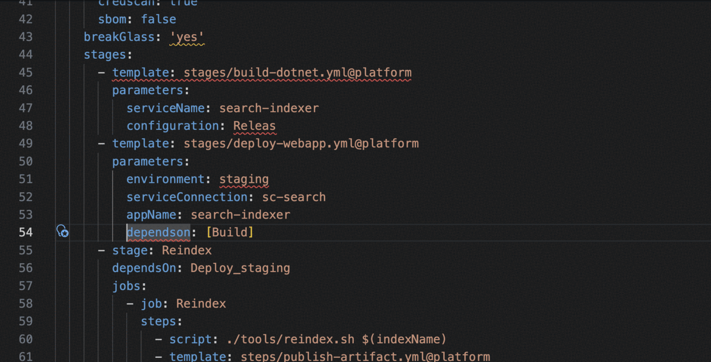 |  |

## Who uses this template?

Check who calls a template before you change it.

- **"N usages · M pipelines"** above a template lists its call sites. Click it.
- **Find All References** (VS Code, <kbd>⇧⌥F12</kbd> / <kbd>Shift+Alt+F12</kbd>) and **Find Usages** (IntelliJ,
  <kbd>⌥F7</kbd> / <kbd>Alt+F7</kbd>) work on a template and on each of its parameters. On a parameter, you get the calls that pass it.
- **Call Hierarchy** shows the whole chain: which templates call this one, which pipelines call those, and so on up to every
  pipeline that reaches it. Use <kbd>⇧⌥H</kbd> / <kbd>Shift+Alt+H</kbd> in VS Code, <kbd>⌃⌥H</kbd> / <kbd>Ctrl+Alt+H</kbd> in
  IntelliJ. It also goes the other way, from a pipeline to everything it calls (the toggle at the top of the view).

| VS Code | IntelliJ |
|---|---|
| 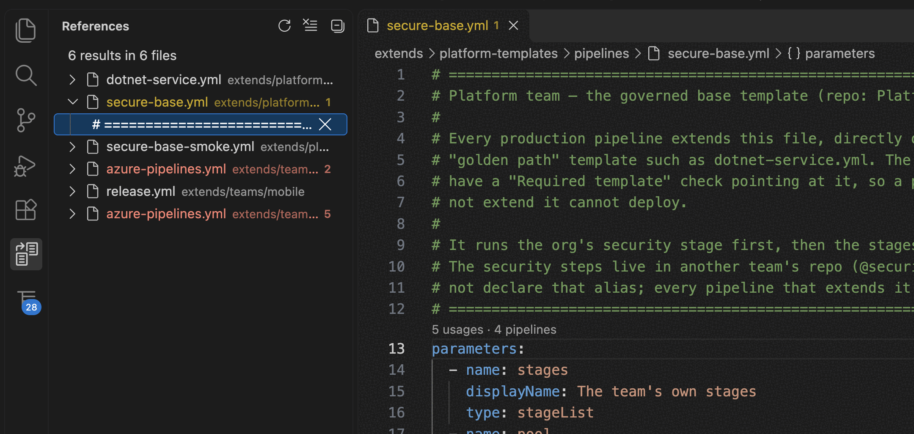 | 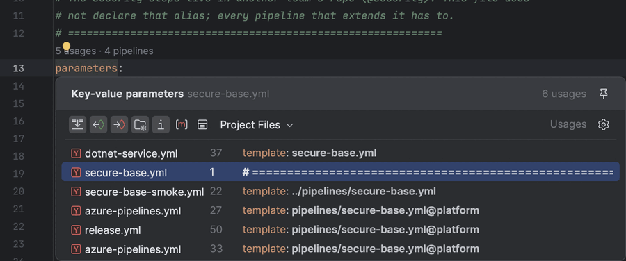 |
|  |  |

## Outline of a pipeline

The Outline (VS Code) and Structure view (IntelliJ) show a pipeline's resources, variables, stages, jobs, steps, template calls
and `${{ if }}` blocks. Use <kbd>⇧⌘O</kbd> / <kbd>Ctrl+Shift+O</kbd> (VS Code) or
<kbd>⌘F12</kbd> / <kbd>Ctrl+F12</kbd> (IntelliJ) to jump to one by typing its name.

| VS Code | IntelliJ |
|---|---|
|  | 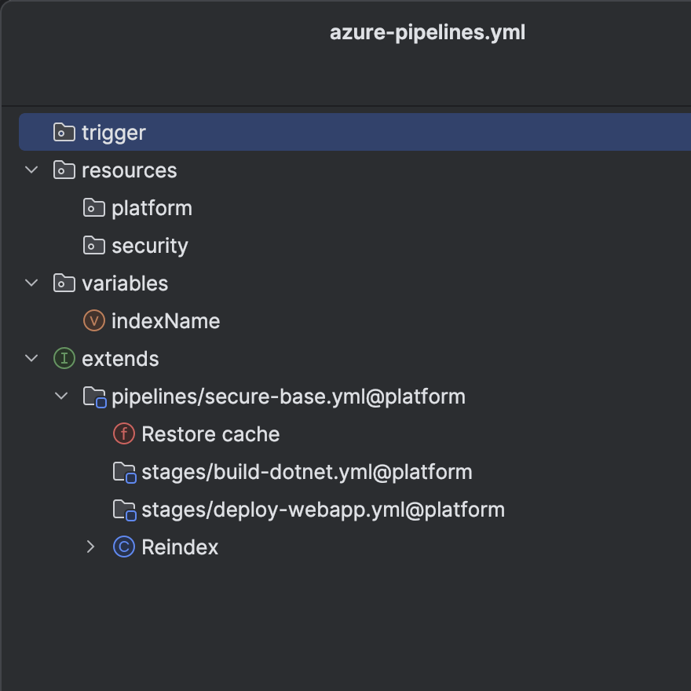 |

## Template graph

The graph draws the current file with its callers and callees, or the whole workspace.

- Bigger nodes are used more.
- Click a node to light up everything that reaches it and everything it calls.
- Filter to problems, to kinds of files, or to repositories.

In VS Code it is the *Template Graph* view in the Azure Templates sidebar; *Open Graph in Editor* gives it a full tab. In
IntelliJ it is the *Graph* tab of the Azure Templates tool window.

| VS Code | IntelliJ |
|---|---|
| 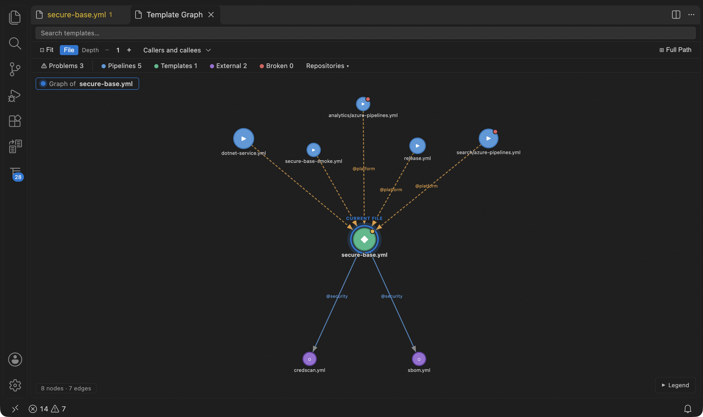 |  |

## Dependencies and Diagnostics

**Dependencies** shows what the current file calls (with each template's folder and parameter count) and what calls it.
**Diagnostics** lists every problem in the workspace, by file.

| VS Code | IntelliJ |
|---|---|
| 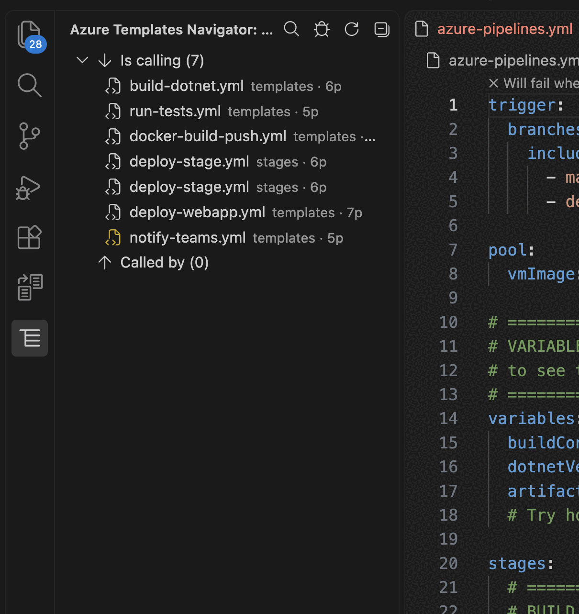 | 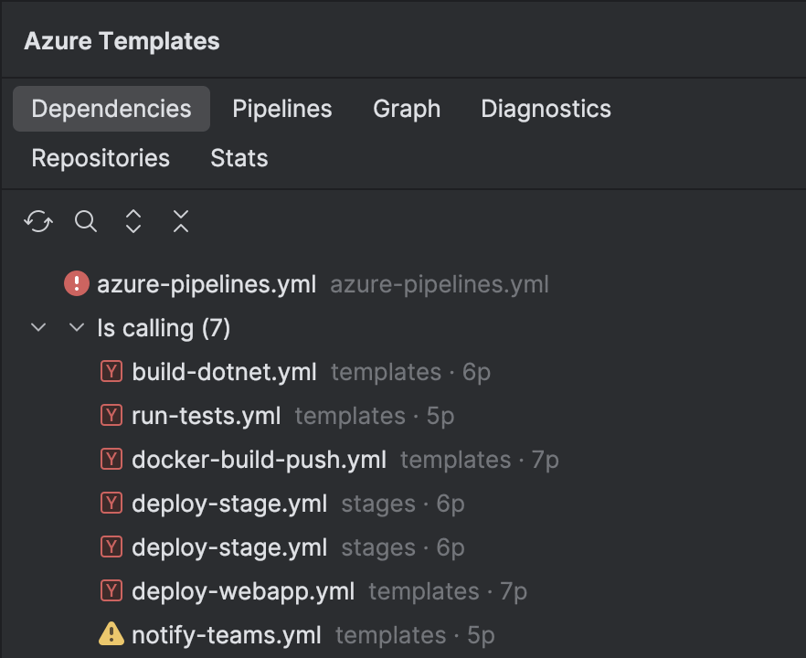 |
|  | 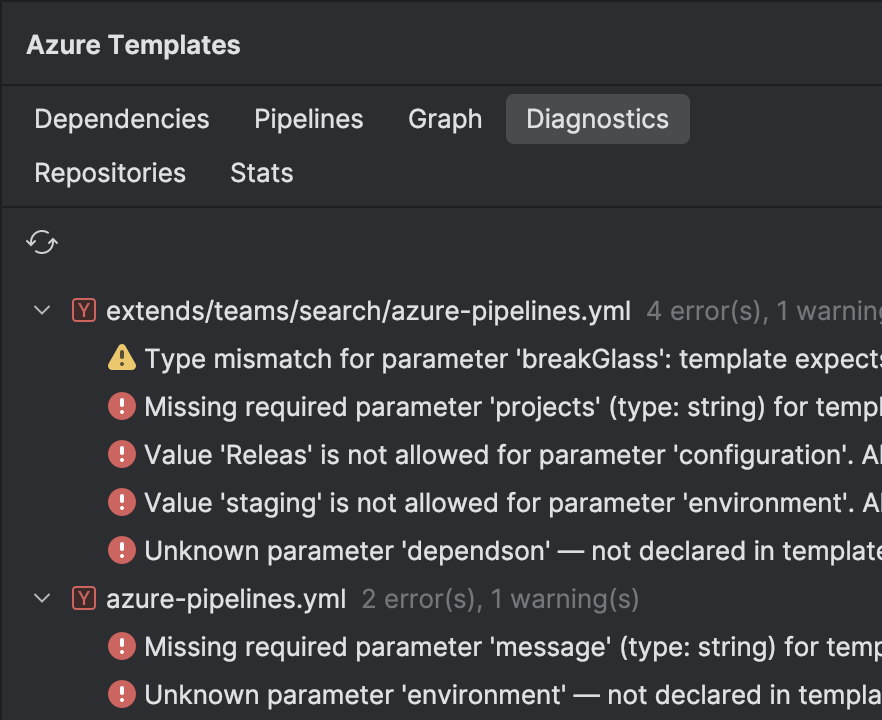 |

## Templates from other repositories

`template: x.yml@templates` works like a local template. The repository declared under `resources.repositories` is downloaded
into a shared cache with your normal git credentials, at the declared `ref`, and refreshed in the background. If you already
have it cloned next to your repository (`../<repo>`), that working copy is used instead, unpushed edits included.

The **Repositories** view (VS Code) or tab (IntelliJ) shows each repository's state, the commit it is on, and the templates you
use from it. Most repositories need no setup: the clone URL is worked out from `resources.repositories` and your own
origin, and the repository is fetched into a shared cache and refreshed in the background.

If a repository shows as *failed* or *unconfigured*, or your templates live in a folder rather than their own
repository, commit `.azure-templates-navigator.json` at the repository root. `urls` pins an alias's clone URL;
`localPaths` points an alias at a folder (relative to the file), which is then read as is, with no download. Everyone
gets the same mapping, in both IDEs and the `atn` CLI, and IDE settings override it. The
[main README](../README.md#templates-from-other-repositories) explains how clone URLs are worked out.

| VS Code | IntelliJ |
|---|---|
| 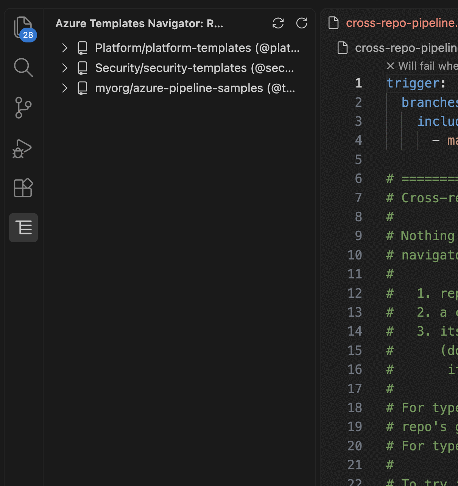 | 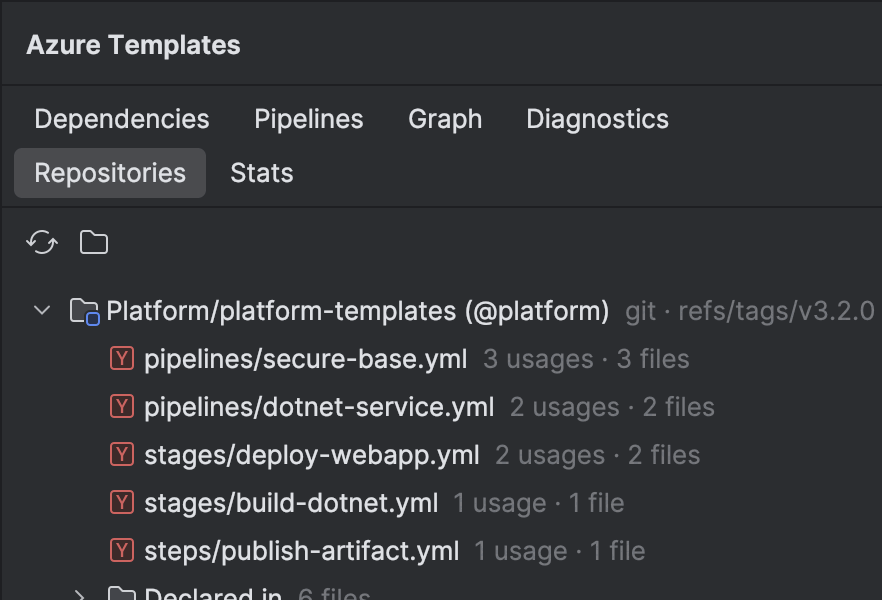 |

## Stats for template owners

If your team publishes templates, the **Stats** view (VS Code) or tab (IntelliJ) shows:

- problems by type
- the most used and the most mis-called templates
- templates nothing in the workspace references
- counts per repository

Click a row to open the file, or use *Show in Graph* to see it in context.

| VS Code | IntelliJ |
|---|---|
| 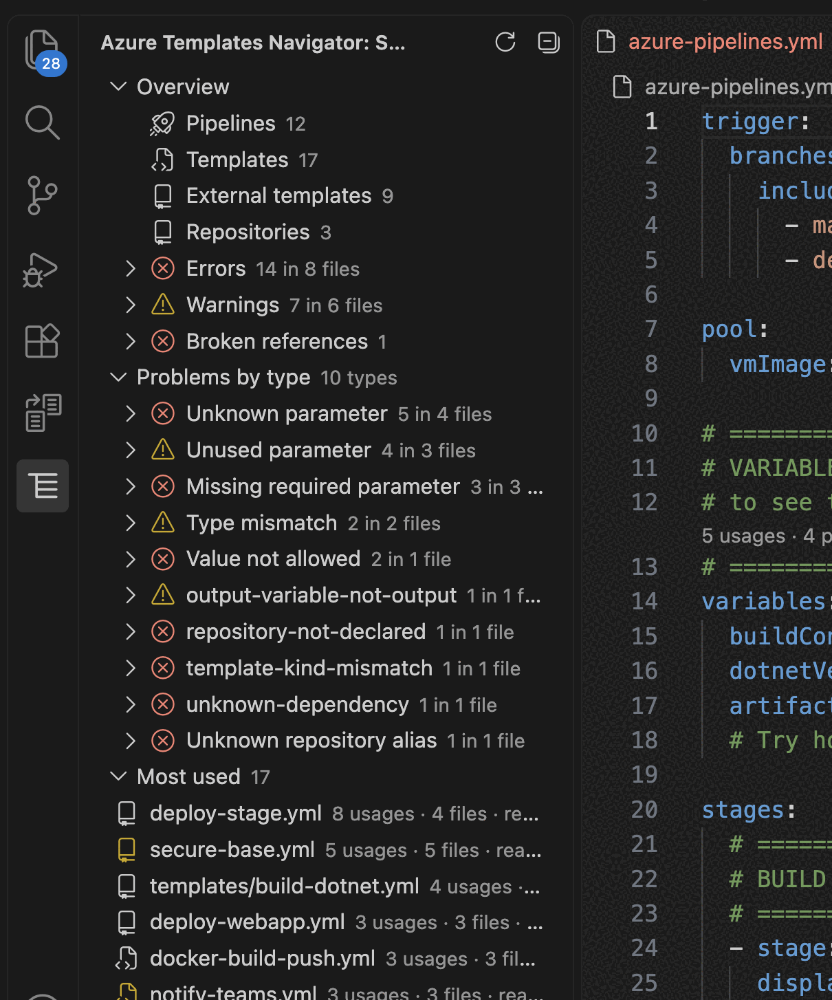 | 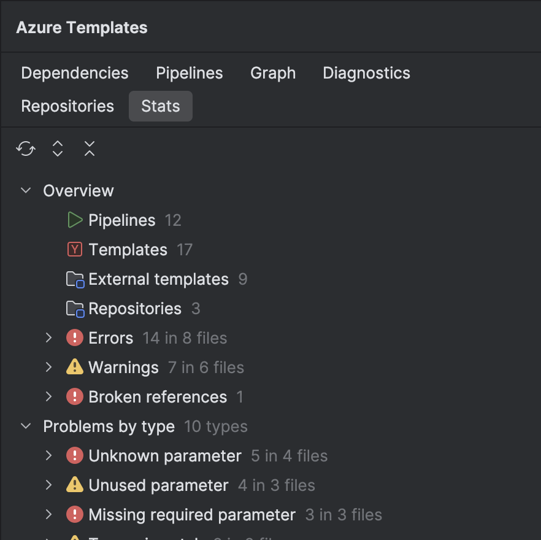 |

## Search templates

*Search Templates…* lists every template and pipeline with its parameters and how many files use it. *Search Template
Parameters…* (editor right-click menu) lists the parameters of the template at the cursor and jumps to one. In VS Code, run them
from the Command Palette. In IntelliJ, they are under *Tools → Azure Templates*.

## Tips, help and feedback

To go through the features one at a time:

- **VS Code:** use the *Get Started* walkthrough. Open it from the *Help and Feedback* view in the Azure Templates sidebar, from
  *Azure Templates: Get Started*, or from *Help → Welcome → Walkthroughs*.
- **IntelliJ:** use *Help → Azure Templates Navigator Tips*, or *Get Started* under the bug button in the tool window header. The
  tips window stays open while you try each feature in the editor. The same tips also show up in *Help → Tip of the Day*.

After an update, both IDEs offer *What's New* once. The same menus also have *Report a Bug* (a GitHub issue with your versions
filled in), *Documentation* (this page) and *Show Log*.

| VS Code | IntelliJ |
|---|---|
|  | 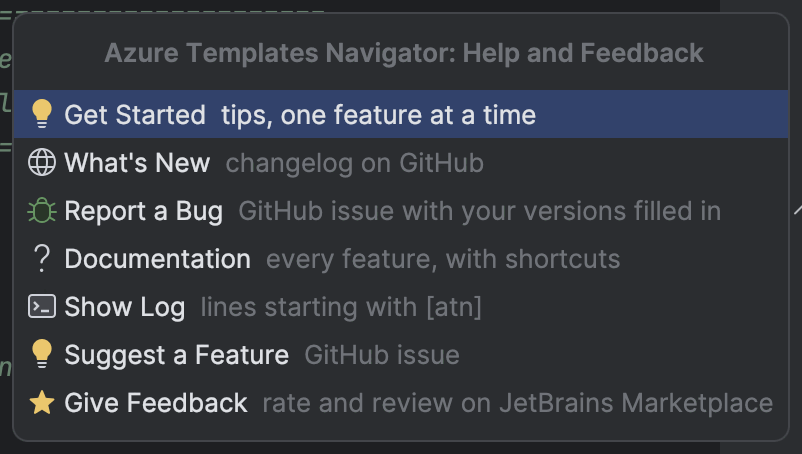 |
|  | |

## In a terminal or a pipeline

The `atn` binary behind both IDEs also runs on its own. `atn check` prints every pipeline's verdict and exits with 1 on errors,
and `--format azure` turns the problems into annotations on an Azure Pipelines run. See the [CLI section of the main
README](../README.md#cli).

---

The screenshots are generated from `samples/`: `node test/screenshots/run.js` in `clients/vscode` for VS Code, and
`node scripts/screenshots/intellij.js` against the IDE that `./gradlew runIdeForScreenshots` starts in `clients/intellij`.
