# Azure Templates Navigator: feature guide

Everything the extension (VS Code) and the plugin (IntelliJ IDEA and the other JetBrains IDEs) do for Azure Pipelines YAML, with
the shortcut for each. Both run the same engine, so a feature behaves the same in both IDEs. Only the place you find it differs.

The screenshots use the repository's [`samples/`](../samples) folder. Open it to try each feature as you read.

- [Shortcuts](#shortcuts)
- [Will this pipeline run?](#will-this-pipeline-run)
- [What did my changes break?](#what-did-my-changes-break) — only the problems your work added
- [Check in Azure DevOps](#check-in-azure-devops) — Azure compiles the pipelines your changes reach (opt-in)
- [A template's parameters](#a-templates-parameters)
- [Complete a template call in one go](#complete-a-template-call-in-one-go)
- [Problems and quick fixes](#problems-and-quick-fixes)
- [Who uses this template?](#who-uses-this-template) — Find Usages and **Call Hierarchy**
- [Outline of a pipeline](#outline-of-a-pipeline)
- [Template graph](#template-graph)
- [Dependencies and Diagnostics](#dependencies-and-diagnostics)
- [Templates from other repositories](#templates-from-other-repositories)
- [Stats for template owners](#stats-for-template-owners)
- [Search templates](#search-templates)
- [Tips, help and feedback](#tips-help-and-feedback)
- [In a terminal or a pipeline](#in-a-terminal-or-a-pipeline)

## Shortcuts

These are the IDEs' default keymaps. Each one runs an IDE feature that the extension feeds, so a shortcut you've remapped in the IDE works here too.

| To | VS Code (macOS / Windows, Linux) | IntelliJ (macOS / Windows, Linux) |
|---|---|---|
| See a template's parameters | hover, or <kbd>⌘K</kbd> <kbd>⌘I</kbd> / <kbd>Ctrl+K</kbd> <kbd>Ctrl+I</kbd> | <kbd>F1</kbd> / <kbd>Ctrl+Q</kbd> (Quick Documentation) |
| Open the template | <kbd>⌘</kbd>-click or <kbd>F12</kbd> / <kbd>Ctrl</kbd>-click or <kbd>F12</kbd> | <kbd>⌘</kbd>-click or <kbd>⌘B</kbd> / <kbd>Ctrl</kbd>-click or <kbd>Ctrl+B</kbd>, or the gutter icon |
| Complete a path, a parameter or a value | <kbd>⌃Space</kbd> / <kbd>Ctrl+Space</kbd> | <kbd>⌃Space</kbd> / <kbd>Ctrl+Space</kbd> |
| Fix the problem at the cursor | <kbd>⌘.</kbd> / <kbd>Ctrl+.</kbd> | <kbd>⌥⏎</kbd> / <kbd>Alt+Enter</kbd> |
| Go to the next problem | <kbd>F8</kbd> | <kbd>F2</kbd> |
| List every problem | <kbd>⇧⌘M</kbd> / <kbd>Ctrl+Shift+M</kbd> (Problems) | <kbd>⌘6</kbd> / <kbd>Alt+6</kbd> (Problems) |
| Find who uses a template or parameter | <kbd>⇧⌥F12</kbd> / <kbd>Shift+Alt+F12</kbd> (Find All References), <kbd>⇧F12</kbd> to peek | <kbd>⌥F7</kbd> / <kbd>Alt+F7</kbd> (Find Usages), <kbd>⌥⌘F7</kbd> / <kbd>Ctrl+Alt+F7</kbd> (Show Usages popup) |
| **See the chain from pipeline to template** | <kbd>⇧⌥H</kbd> / <kbd>Shift+Alt+H</kbd> (Show Call Hierarchy) | <kbd>⌃⌥H</kbd> / <kbd>Ctrl+Alt+H</kbd> (Call Hierarchy) |
| Jump to a stage, job or step | <kbd>⇧⌘O</kbd> / <kbd>Ctrl+Shift+O</kbd> (Go to Symbol in Editor) | <kbd>⌘F12</kbd> / <kbd>Ctrl+F12</kbd> (File Structure) |
| Run any of the extension's commands | <kbd>⇧⌘P</kbd> / <kbd>Ctrl+Shift+P</kbd>, then type *Azure Templates* | <kbd>⇧⌘A</kbd> / <kbd>Ctrl+Shift+A</kbd> (Find Action), or *Tools → Azure Templates* |

## Will this pipeline run?

Every pipeline shows a verdict above its first line. It covers the pipeline and every template the pipeline reaches, so a broken
template shows up on each pipeline that uses it. Errors mean Azure DevOps rejects the run when it is queued. Warnings mean the run
starts but is likely to fail or misbehave.

Click the verdict to list the problems, each at the line in the pipeline that leads to it. *Check Pipeline Before Running* in
the editor's right-click menu does the same. The **Pipelines** view (VS Code) or tab (IntelliJ) lists every pipeline in the
workspace, failing first.

| VS Code | IntelliJ |
|---|---|
| 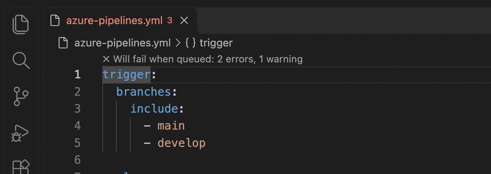 |  |
|  |  |
|  | |

## What did my changes break?

In a big repository, the Pipelines view may say that 8 of 12 pipelines will fail, and that was already true before you started.
After you change a template, you need to know whether *your* change added anything. **My changes** answers that. It compares the
workspace with the commit your work started from, including commits you have already pushed, uncommitted edits and unsaved
editors. Under the row that says where your work started, it lists:

- the files you changed, with the problems each one added or fixed and how many pipelines use it;
- the big picture: what your changes added and fixed, and how many pipelines fail in total. Click it to go back to every pipeline;
- each pipeline your changes reach, with its new problems, the problems it no longer has (*fixed*) and the count already there
  before you started.

A problem counts as new only if it wasn't there before. Moving lines around doesn't make an old problem new, and a problem in a
template that three pipelines use counts once in the totals. A file you rename shows its problems as fixed under the old name and
new under the new one.

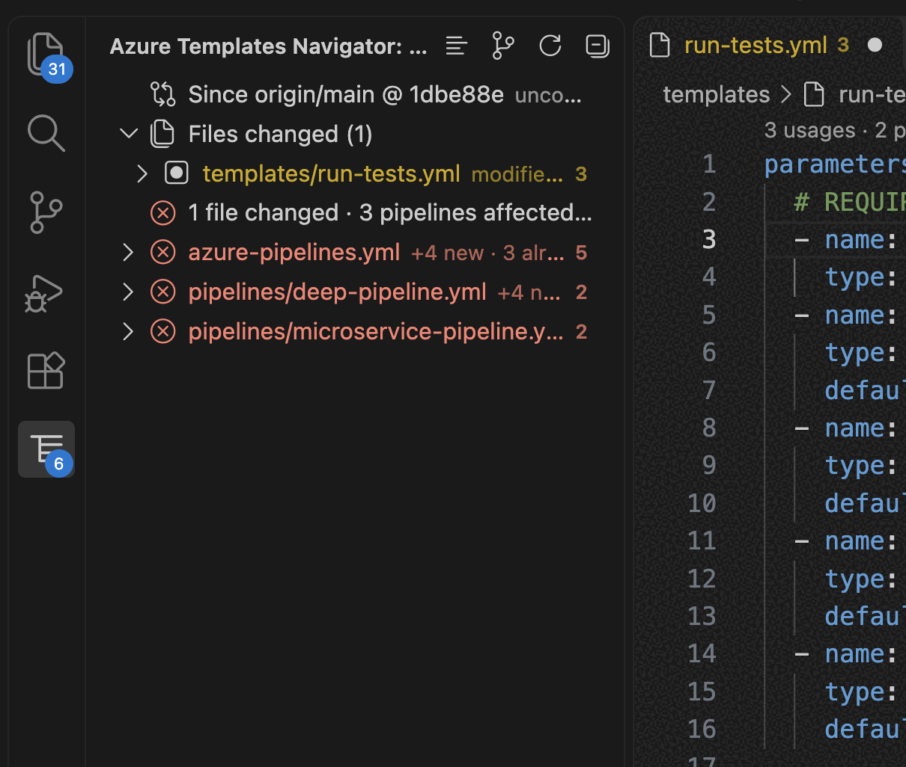

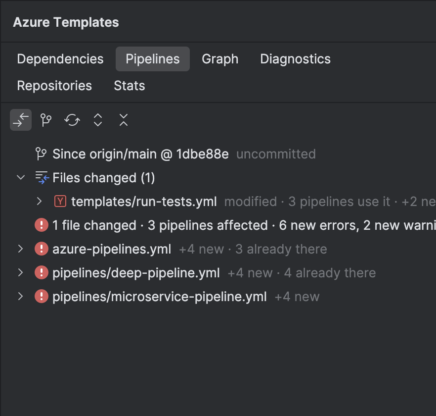

**Switch between the two views** with the button in the Pipelines view title (VS Code) or *Only My Changes* in the Pipelines
tab's toolbar (IntelliJ). The **Diagnostics** view (tab) has the same buttons and follows the same switch: in My changes it lists
only the problems your changes added, and says how many that were already there it hides. In the full list, problems your changes added say *new*, and so does the verdict above the pipeline:
*✗ Will fail when queued: 41 errors · +2 new since feature/story*.

**Where your work started** is shown on the first row. Git doesn't record which branch a branch came from, so it is a guess:

1. on `main` (or the default branch): your unpushed commits and uncommitted changes, compared with `origin/main`;
2. on a branch you created from another one (`git switch -c mywork` while on `feature/story`): where your branch splits from
   `feature/story`. This stays right after you rebase or merge `feature/story` in;
3. on a branch you checked out from the remote, or when there's no record of where it came from: where it splits from the
   default branch.

To compare with something else, click that row (or *Compare My Changes With…* in the view title or toolbar). The options are
*Automatic*, *Uncommitted changes only*, a recent branch, or any branch, tag or commit you type in. The choice is remembered for the branch
(in `git config branch.<name>.atnBase`), so the CLI and the other IDE use it too.

**Quiet the Problems panel** with `azure-templates-navigator.changes.dimExistingProblems` (VS Code) or *Show problems that were
already there before my changes as information* (IntelliJ settings). Errors and warnings that were already there at the base then
show as information, ending with *(already there at origin/main)*, so the Problems panel's errors and warnings are the ones your
changes added. The verdicts, the Pipelines view and the CLI keep the real severities. It is off by default.

Turn it off with `azure-templates-navigator.changes.enabled` (VS Code) or *Show what my changes added and fixed* in the
settings (IntelliJ). It needs a git repository and the `git` command.

## Check in Azure DevOps

atn's checks run on your machine and can be wrong. Azure DevOps itself can compile a pipeline without running it (the *preview*
API, the same as the pipeline editor's *Validate*). **Check in Azure DevOps** asks it to, for every pipeline your changes reach,
twice: at the commit your work started from, and with your changes. It then shows:

- whether each pipeline **compiles** or is **rejected**, and what it was at the base (in the tooltip);
- the problems Azure reports, at the line it gives, with the ones your changes added marked *new*: *✗ rejected (1 problem, 1
  new)* means your changes broke it;
- whether atn agrees: *atn agrees*, *atn found no error here* (please [report it](#tips-help-and-feedback)), or *atn reports
  errors Azure accepts*;
- **Expanded YAML changed (+12 −3)**: the whole pipeline as Azure expanded it, at the base and with your changes, in a diff
  editor. This shows what a template change really does to each pipeline that uses it.

It is off by default, and asks before each check.

**Turn it on** with `azure-templates-navigator.azure.enabled` (VS Code) or *Offer to check my changes in Azure DevOps*
(IntelliJ settings), or run *Azure Templates: Check in Azure DevOps* from the Command Palette (VS Code) or
*Check in Azure DevOps* in the Pipelines tab's toolbar (IntelliJ): both offer to turn it on.

**Start a check** in My changes (see [What did my changes break?](#what-did-my-changes-break)): the cloud button in the
Pipelines view title or the *Check in Azure DevOps* row (VS Code, shown once it is on), or the toolbar action or that row
(IntelliJ). The results stay under each pipeline until the next check, and say *out of date* once you edit something they
depend on. The verdict above each pipeline ends with the Azure result too.

**What it sends.** Azure only compiles what is on its server, so your changed YAML files (including unsaved editors) are first
pushed as one commit on top of the base, to a ref of their own: `refs/atn/preview/<you>/<branch>`. It is not a branch, so it
doesn't show in the branch list, start CI runs or open pull requests, and it is deleted after the check. The dialog lists the
organization, your account, each file and ref it pushes, and each pipeline it checks. *Always for this workspace* (VS Code) or
*Don't ask again* (IntelliJ) skips it next time. No run is queued.

**Signing in.** It uses the Azure CLI: run `az login` once (add `--allow-no-subscriptions` if your account has no Azure
subscription). It finds your organization's tenant on its own and asks `az` for a token for that tenant, so you don't need a
personal access token. The token is kept in memory only. A token in `ATN_AZURE_TOKEN` is used instead when it is set (and
`SYSTEM_ACCESSTOKEN` in a pipeline, which hasn't been tried yet: the build service needs *Contribute* on the repository to push
the snapshot).

**What can be checked.** A pipeline is checked when it is in an Azure Repos git repository and an Azure DevOps pipeline uses
that file. A pipeline with no Azure DevOps pipeline, a GitHub repository, or a file with no origin on `dev.azure.com` is listed
as *not checked*, with the reason. Runtime parameters with no default get the first allowed value, or one of their type.

If a repository refuses the push (a branch policy, or no permission to create refs), the pipelines that need it say *couldn't
check* with the server's reason, and the others are still checked. No branch is created instead.

A change to a templates repository counts only when that repository is open too (a folder of the VS Code workspace, or a
module in IntelliJ), or with `atn validate --root app --root templates`. A clone next to the project that is only used to
resolve `@templates` is read, not pushed.

Azure's compile check covers what makes a run fail when it is queued: YAML, templates and their parameters, `dependsOn`,
expressions, tasks and environments. It doesn't check agent pools, variable groups, service connections or task inputs, and it
compiles each pipeline for a manual run, so `${{ if eq(variables['Build.Reason'], 'PullRequest') }}` branches aren't taken.

**What it doesn't do yet:**
- check every flow of a template (each `${{ if }}` branch, parameter values, the pipelines that don't use it yet): planned
  next;
- sign in with VS Code's own Microsoft account (only the Azure CLI or a token);
- check pipelines in GitHub repositories, or templates that live in GitHub;
- count changes in a templates repository that isn't open in the workspace;
- run in Azure Pipelines with `SYSTEM_ACCESSTOKEN`: it should work, but hasn't been tried.

Settings: `azure-templates-navigator.azure.enabled`, `azure.keepSnapshots` (keep the refs after the check, to look at them) and
`azure.azPath` (VS Code), or *Check in Azure DevOps* in the settings (IntelliJ). In a terminal: [`atn validate`](../README.md#cli).

## A template's parameters

Hover a `template:` line (VS Code), or put the caret on it and press <kbd>F1</kbd> / <kbd>Ctrl+Q</kbd> (IntelliJ). You see every
parameter with its type, default and allowed values, and the required ones are marked. The same works on:

- a parameter you pass (`  env: prod`)
- `${{ parameters.x }}` inside a template
- `$(variable)` and `variables.x`: the value and the line that sets it

<kbd>⌘</kbd>/<kbd>Ctrl</kbd>-click opens the template. In IntelliJ the gutter icon next to `template:` does too.

| VS Code | IntelliJ |
|---|---|
|  | 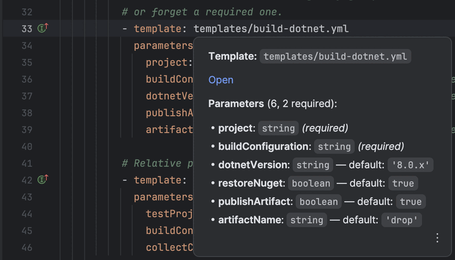 |
|  | |

## Complete a template call in one go

After `template:`, completion lists the templates in the workspace and in the repositories you declared. Picking one also
inserts a `parameters:` block with the template's required parameters. Press Tab to move between their values.

Under `parameters:`, completion offers the template's parameter names, required first, and then their allowed values. To insert
only the path, turn off `completion.requiredParameters`: in VS Code it's under *Settings → Azure Templates Navigator*, in IntelliJ
under *Settings → Tools → Azure Templates Navigator*.

| VS Code | IntelliJ |
|---|---|
|  | 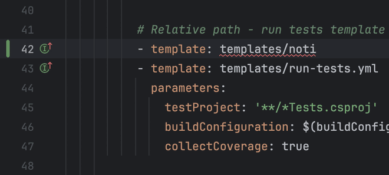 |

## Problems and quick fixes

Problems are reported as you type, on the line that causes them. Most have a quick fix: <kbd>⌘.</kbd> / <kbd>Ctrl+.</kbd> in
VS Code, <kbd>⌥⏎</kbd> / <kbd>Alt+Enter</kbd> in IntelliJ.

| Problem | Quick fix |
|---|---|
| Missing required parameter | Add it, or add every missing one |
| Unknown parameter ("did you mean …?") | Rename it, or remove it |
| Wrong type (`'yes'` for a `boolean`) | Replace it with the right literal |
| Value not in `values:` | Pick an allowed value |
| Parameter declared but never used | Remove the declaration |
| Repository not downloaded | Fetch it |
| Template not found, unknown `@alias`, a GitHub or Bitbucket repository without `endpoint:`, a template of the wrong kind (steps where stages go), `dependsOn` on a stage or job that doesn't exist, an output variable that isn't set as an output | — |

| VS Code | IntelliJ |
|---|---|
|  | 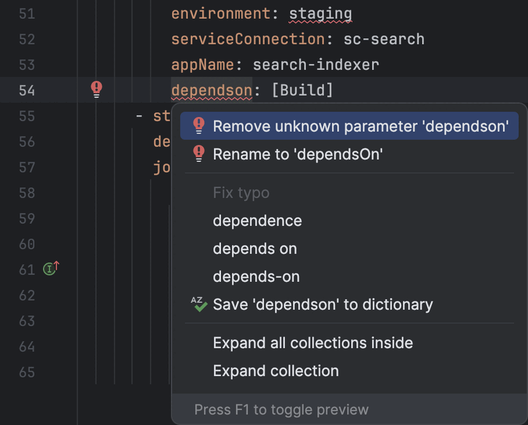 |

## Who uses this template?

Check who calls a template before you change it.

- **"N usages · M pipelines"** above a template lists its call sites. Click it.
- **Find All References** (VS Code, <kbd>⇧⌥F12</kbd> / <kbd>Shift+Alt+F12</kbd>) and **Find Usages** (IntelliJ,
  <kbd>⌥F7</kbd> / <kbd>Alt+F7</kbd>) work on a template and on each of its parameters. On a parameter, you get the calls that pass it.
- **Call Hierarchy** shows the whole chain: which templates call this one, which pipelines call those, and so on up to every
  pipeline that reaches it. Use <kbd>⇧⌥H</kbd> / <kbd>Shift+Alt+H</kbd> in VS Code, <kbd>⌃⌥H</kbd> / <kbd>Ctrl+Alt+H</kbd> in
  IntelliJ. It also goes the other way, from a pipeline to everything it calls (the toggle at the top of the view).

| VS Code | IntelliJ |
|---|---|
|  |  |
| 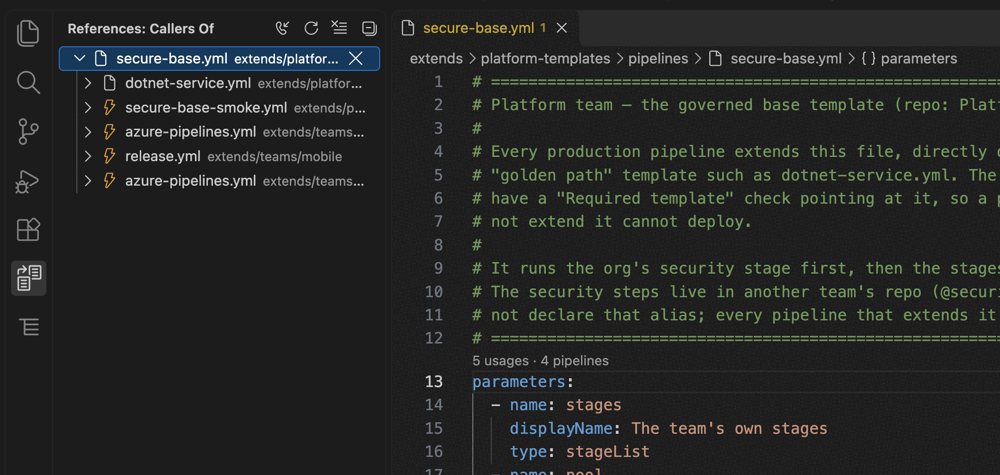 | 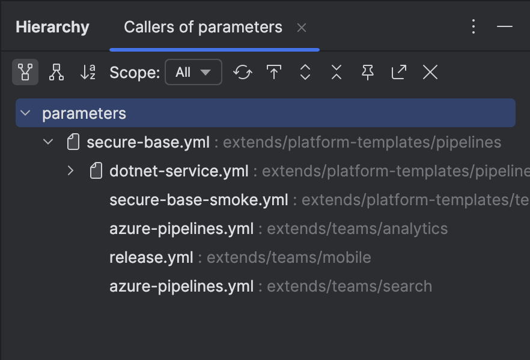 |

## Outline of a pipeline

The Outline (VS Code) and Structure view (IntelliJ) show a pipeline's resources, variables, stages, jobs, steps, template calls
and `${{ if }}` blocks. Use <kbd>⇧⌘O</kbd> / <kbd>Ctrl+Shift+O</kbd> (VS Code) or
<kbd>⌘F12</kbd> / <kbd>Ctrl+F12</kbd> (IntelliJ) to jump to one by typing its name.

| VS Code | IntelliJ |
|---|---|
| 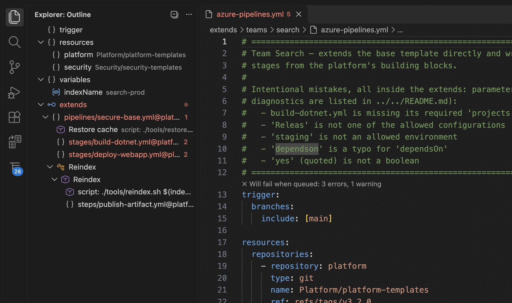 |  |

## Template graph

The graph draws the current file with its callers and callees, or the whole workspace.

- Bigger nodes are used more.
- Click a node to light up everything that reaches it and everything it calls.
- Filter to problems, to kinds of files, or to repositories.

In VS Code it is the *Template Graph* view in the Azure Templates sidebar; *Open Graph in Editor* gives it a full tab. In
IntelliJ it is the *Graph* tab of the Azure Templates tool window.

| VS Code | IntelliJ |
|---|---|
|  | 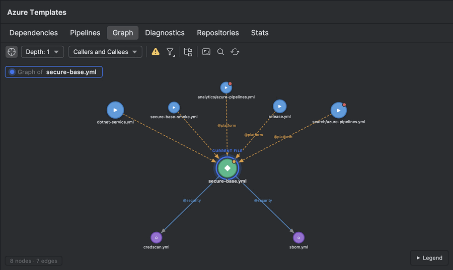 |

## Dependencies and Diagnostics

**Dependencies** shows what the current file calls (with each template's folder and parameter count) and what calls it.
**Diagnostics** lists every problem in the workspace, by file.

| VS Code | IntelliJ |
|---|---|
|  |  |
| 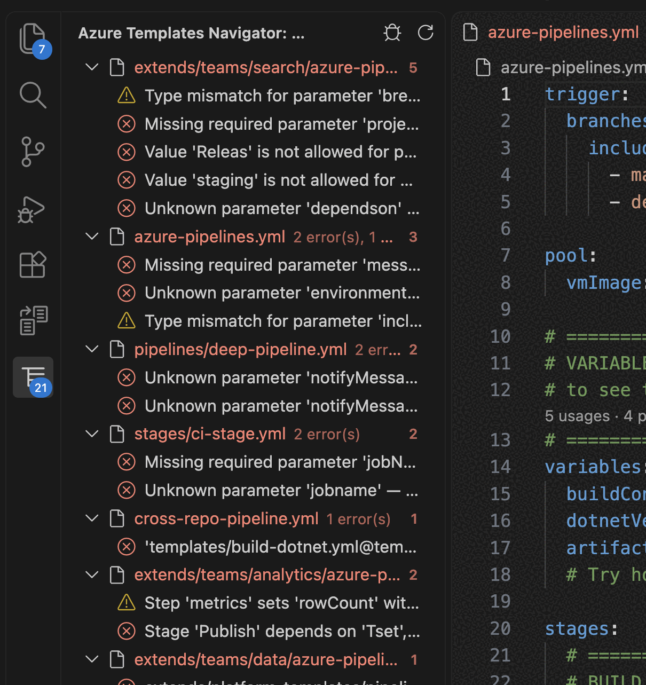 |  |

## Templates from other repositories

`template: x.yml@templates` works like a local template. The repository declared under `resources.repositories` is downloaded
into a shared cache with your normal git credentials, at the declared `ref`, and refreshed in the background. If you already
have it cloned next to your repository (`../<repo>`), that working copy is used instead, unpushed edits included.

The **Repositories** view (VS Code) or tab (IntelliJ) shows each repository's state, the commit it is on, and the templates you
use from it. Most repositories need no setup: the clone URL is worked out from `resources.repositories` and your own
origin, and the repository is fetched into a shared cache and refreshed in the background.

If a repository shows as *failed* or *unconfigured*, or your templates live in a folder rather than their own
repository, commit `.azure-templates-navigator.json` at the repository root. `urls` pins an alias's clone URL;
`localPaths` points an alias at a folder (relative to the file), which is then read as is, with no download. Everyone
gets the same mapping, in both IDEs and the `atn` CLI, and IDE settings override it. The
[main README](../README.md#templates-from-other-repositories) explains how clone URLs are worked out.

| VS Code | IntelliJ |
|---|---|
|  |  |

## Stats for template owners

If your team publishes templates, the **Stats** view (VS Code) or tab (IntelliJ) shows:

- problems by type
- the most used and the most mis-called templates
- templates nothing in the workspace references
- counts per repository

Click a row to open the file, or use *Show in Graph* to see it in context.

| VS Code | IntelliJ |
|---|---|
|  |  |

## Search templates

*Search Templates…* lists every template and pipeline with its parameters and how many files use it. *Search Template
Parameters…* (editor right-click menu) lists the parameters of the template at the cursor and jumps to one. In VS Code, run them
from the Command Palette. In IntelliJ, they are under *Tools → Azure Templates*.

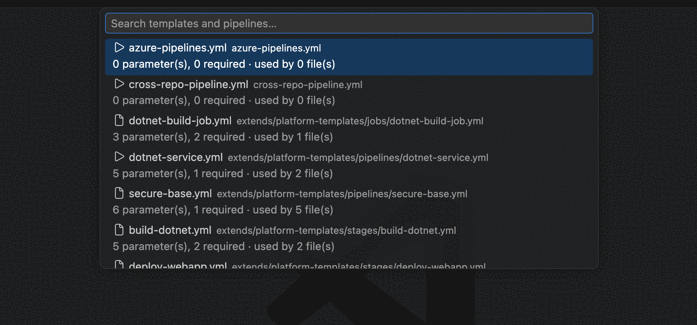

## Tips, help and feedback

To go through the features one at a time:

- **VS Code:** use the *Get Started* walkthrough. Open it from the *Help and Feedback* view in the Azure Templates sidebar, from
  *Azure Templates: Get Started*, or from *Help → Welcome → Walkthroughs*.
- **IntelliJ:** use *Help → Azure Templates Navigator Tips*, or *Get Started* under the bug button in the tool window header. The
  tips window stays open while you try each feature in the editor. The same tips also show up in *Help → Tip of the Day*.

After an update, both IDEs offer *What's New* once. The same menus also have *Report a Bug* (a GitHub issue with your versions
filled in), *Documentation* (this page) and *Show Log*.

| VS Code | IntelliJ |
|---|---|
| 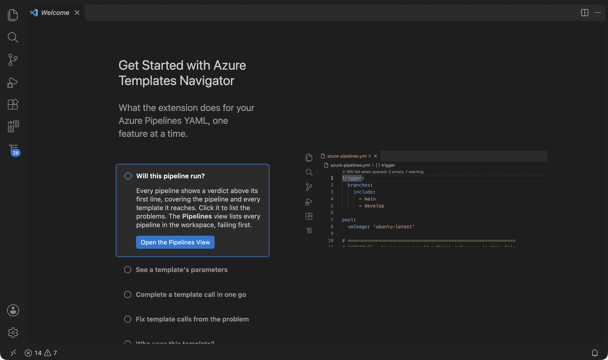 |  |
| 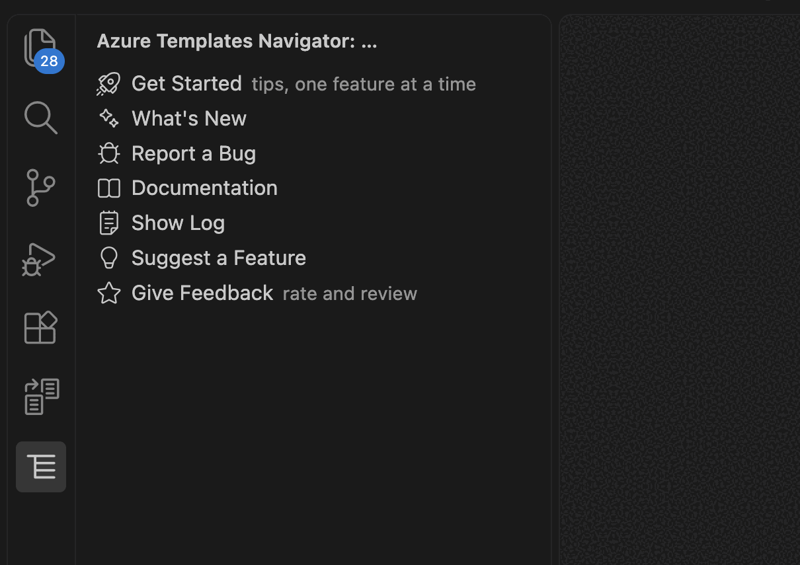 | |

## In a terminal or a pipeline

The `atn` binary behind both IDEs also runs on its own. `atn check` prints every pipeline's verdict and exits with 1 on errors,
and `--format azure` turns the problems into annotations on an Azure Pipelines run. `atn check --since origin/main` reports
and fails on only the problems that are new since `origin/main`, so a repository can gate pull requests before its existing
problems are fixed. `atn validate` asks Azure DevOps to compile the pipelines your changes reach (see [Check in Azure
DevOps](#check-in-azure-devops)). See the [CLI section of the main
README](../README.md#cli).

---

The screenshots are generated from `samples/`: `node test/screenshots/run.js` in `clients/vscode` for VS Code, and
`node scripts/screenshots/intellij.js` against the IDE that `./gradlew runIdeForScreenshots` starts in `clients/intellij`.
